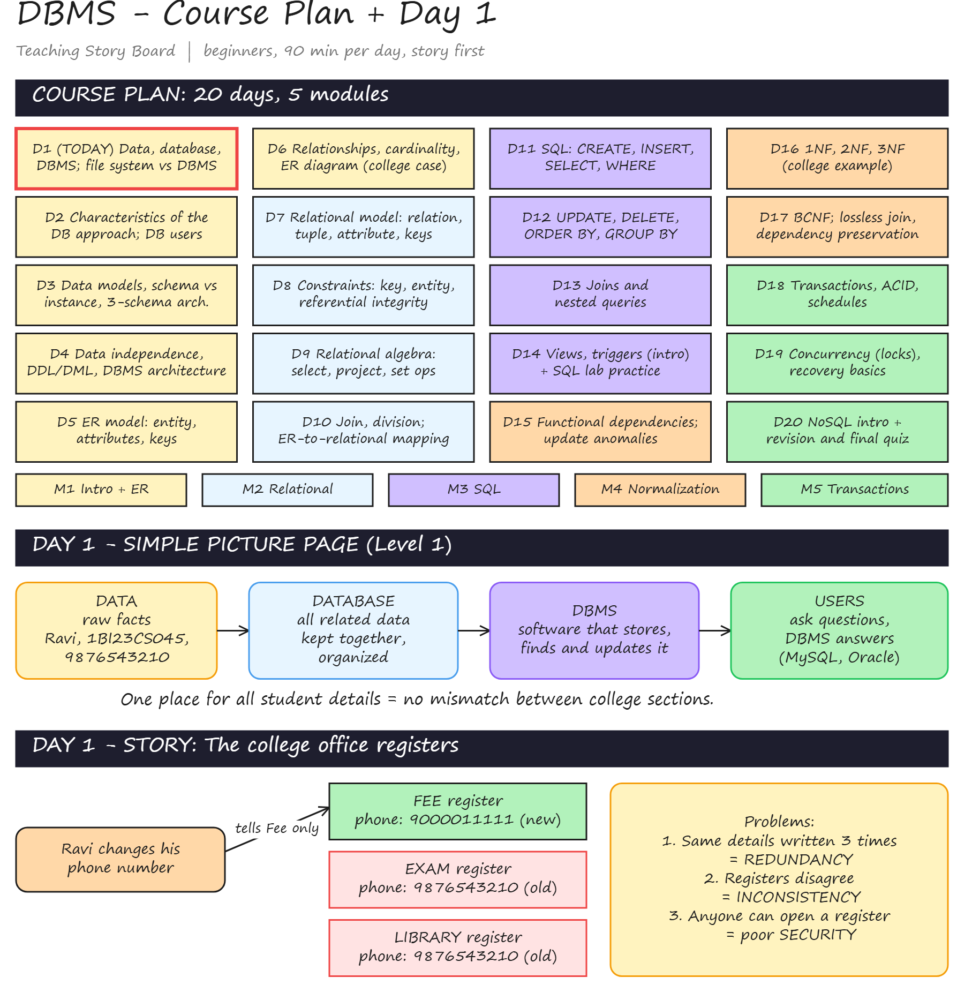
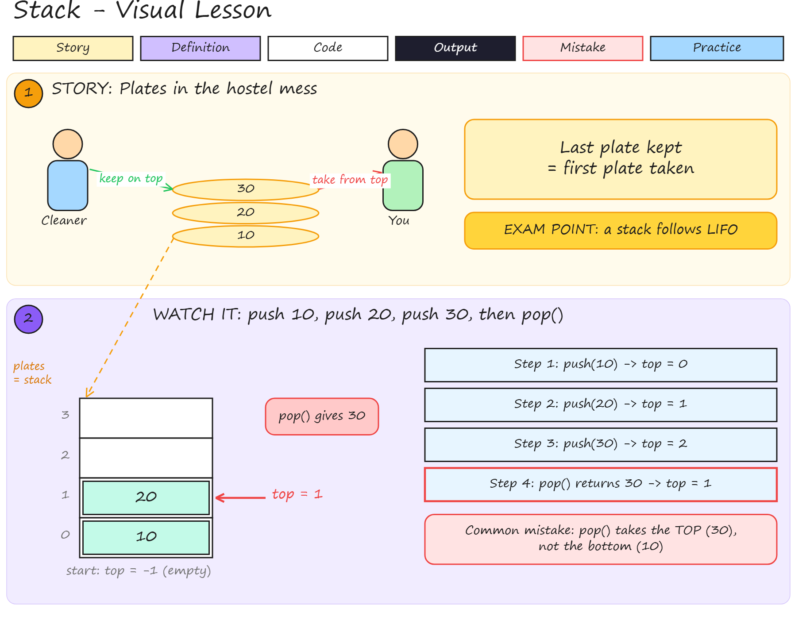

# Story-First Learning Skills for Claude

Made by **B ARAVIND**, BITM

I teach C programming and DBMS to students who are often seeing these subjects for the
first time. What works in my classroom is simple: start with a story from daily life,
connect it to the technical word, and only then show the definition, the syntax and the
program. I put that way of teaching into three Claude skills so that my colleagues and
students can use the same method.

Every answer is drawn on an Excalidraw board, in the same order every time:

Story -> Connect -> Definition -> Syntax / Formula -> Example -> Mistakes -> Practice -> Next step

## The three skills

| Skill | Who it is for | What you get |
|---|---|---|
| `story-teaching-boards` | Teachers | Two boards per course. A Teaching Story Board (course plan, each day's theory, revision, project) and a Code Board (programs, lab cards, 20 practice questions per day with solutions) |
| `story-study-coach` | Students | One topic at a time on a board, with 3 check questions after each step. Also exam answer writing, lab and viva help, study plans |
| `interview-prep-coach` | Final-year students | Prep plan, core subjects, coding with test cases, aptitude, group discussion, mock interviews with scores |

## Install

On claude.ai (web, desktop or mobile app):

1. Open the `dist` folder in this repo and download the zip you need
   (click the file, then "Download raw file").
2. In Claude go to Customize > Skills, click "+", then "Upload a skill" and choose the zip.
   Do not unzip it.
3. Turn on the Excalidraw connector in Customize > Connectors. The boards are drawn with it.
4. Start a new chat.

In Claude Code:

```bash
git clone https://github.com/ARAVIND2017/bitm-learning-skills.git
mkdir -p ~/.claude/skills
cp -r bitm-learning-skills/skills/* ~/.claude/skills/
```

## Example 1: Teacher (story-teaching-boards)

Step 1. Type this in a new chat:

```
Use story-teaching-boards: DBMS course for beginners, 90 min.
List the topics day by day, then make the full Day 1 theory board.
```

Step 2. Claude draws the Teaching Story Board. First the 20-day course plan (coloured by
module, today's day marked in red), then Day 1: a simple picture page, the story of the
college office registers, the definitions, a file system vs DBMS table, two MySQL
examples with output, 6 common mistakes and practice questions.



Step 3. The chat reply stays short, for example:

```
Teaching Story Board: added the course plan and Day 1.
Board id: f1fe3b1d97da462fae
Shall I add the Day 1 programs and 20 questions to the Code Board, or go to Day 2?
Checked: outputs run
```

Step 4. Say "Code Board for Day 1" to get the programs and questions, or "next day"
to add Day 2 below Day 1 on the same board.

## Example 2: Student (story-study-coach)

Step 1. Type:

```
Teach me stack in DSA
```

Step 2. Claude draws the lesson. The story is plates in the hostel mess, the plates are
linked to the stack, and the stack is animated: push 10, push 20, push 30, then pop.



Step 3. The reply asks three questions:

```
Drew Step 1 of stack on the board. Answer these here:
1. What does LIFO stand for?
2. push 5, push 8, pop, push 2. What is on top now?
3. Name one app feature that works like a stack.
```

Step 4. Answer in the chat. If an answer is wrong, the coach explains that part again
with a new example. When all three are right, the next step is drawn below.

## Example 3: Interview practice (interview-prep-coach)

Step 1. Type:

```
Take a mock technical interview on C
```

Step 2. Claude asks one question at a time, like a real interviewer:

```
Q1. What is the difference between a pointer and an array?
```

Step 3. After your answer you get a score out of 5, what was missing, a better answer
and a follow-up question. At the end a scorecard is drawn on a board: total score,
strengths, top 3 gaps and what to study in the next 3 days.

## Tips

- Use the same chat to continue a course or topic. Start a new chat for a new subject.
- The newest drawing at the bottom of the chat is the current board.
- To continue a board in a new chat, paste the Board id from the last reply.
- Say "make it simpler" if a board feels heavy.
- Upload your syllabus PDF to the Claude Project. The course plan will then follow your
  real module and lab numbers.

## If something does not work

| Problem | What to do |
|---|---|
| The skill does not start | Check it is switched on in Customize > Skills, and name it in your message |
| Upload error | Upload the zip from `dist` as it is, without unzipping or renaming |
| No drawing appears | Turn on the Excalidraw connector |

## Updating a skill

Edit `skills/<skill-name>/SKILL.md`, rebuild the zip, then upload it again on claude.ai:

```bash
cd skills && zip -r ../dist/<skill-name>.zip <skill-name> && cd ..
```

## Author

B ARAVIND, BITM

Free to use and adapt for teaching. See [LICENSE](LICENSE).
